<div align="center">


# ShareBro

**Your trip photos, sorted by face — and sent to every friend in a tap.**

<sub>Made by <a href="https://github.com/Yeamin-Talukder"><b>Md Yeamin Talukder</b></a></sub>

[](https://github.com/Yeamin-Talukder/ShareBro/releases/latest)
[](https://github.com/Yeamin-Talukder/ShareBro/releases)
[](https://github.com/Yeamin-Talukder/ShareBro)
[](https://github.com/Yeamin-Talukder/ShareBro/stargazers)
<br>


ShareBro is an offline Android app for the friend who takes all the photos.
It finds every face in your gallery, groups the photos by person, and sends
each friend their own photos straight to their phone — over Wi-Fi, a
hotspot, or with no network at all. No cloud, no uploads, no accounts.

### [⬇️ Download the latest APK](https://github.com/Yeamin-Talukder/ShareBro/releases/latest)

<sub>Most phones: <code>ShareBro-…-arm64-v8a.apk</code> · Android 9 or newer</sub>

<br>

<a href="docs/sharebro-reel.mp4">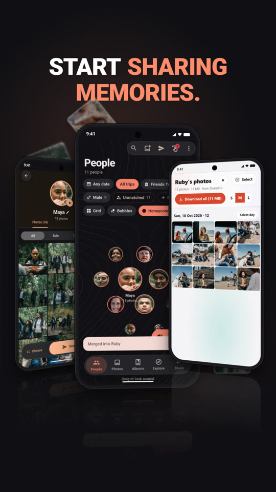</a>

<sub>▶️ <a href="docs/sharebro-reel.mp4"><b>Watch the 1-minute video</b></a></sub>

</div>

---

## Contents

- [Why ShareBro](#why-sharebro)
- [See it in action](#see-it-in-action)
- [Highlights](#highlights)
- [Features in detail](#features-in-detail)
- [Install](#install)
- [How it works](#how-it-works)
- [Privacy and security](#privacy-and-security)
- [Android version support](#android-version-support)
- [Build from source](#build-from-source)
- [Project structure](#project-structure)
- [Tech stack](#tech-stack)
- [Troubleshooting](#troubleshooting)
- [Release history](#release-history)
- [Known limitations](#known-limitations)
- [Contributing](#contributing)
- [Developer](#developer)
- [Credits and third-party licences](#credits-and-third-party-licences)
- [License](#license)

---

## Why ShareBro

After a group trip you have 5,000 photos and ten friends who each want
*their* photos. Normally that means scrolling for hours, picking photos one
by one, and sending them through apps that shrink them.

ShareBro does it in three steps:

1. **Scan** the trip's album or folder once. Every face is found and the
   photos are grouped into one page per person.
2. **Check** the groups. Name people, fix the odd mistake, merge two groups
   of the same person.
3. **Send.** Each friend gets exactly the photos they're in, at full
   quality, straight to their phone.

<table>
  <tr>
    <td align="center" width="33%">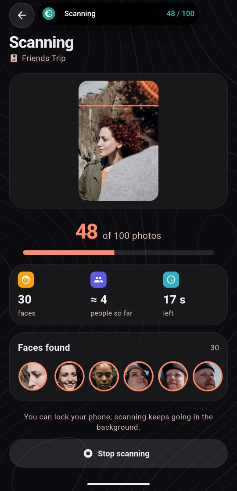</td>
    <td align="center" width="33%">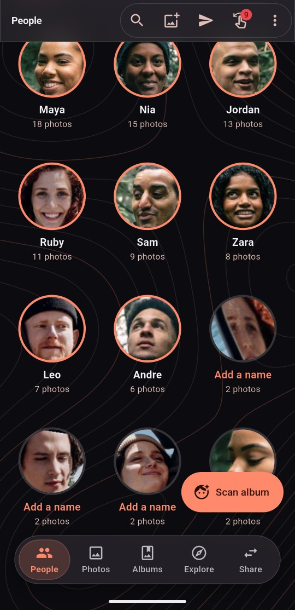</td>
    <td align="center" width="33%">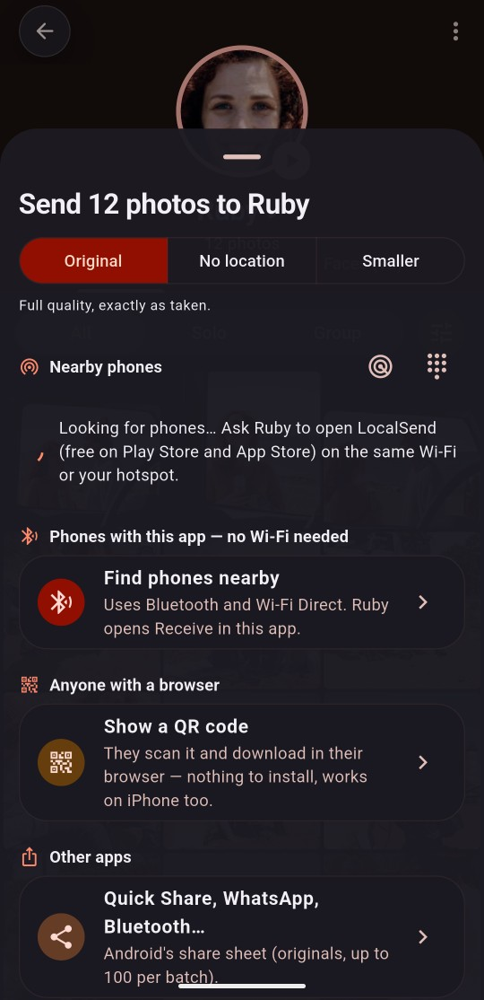</td>
  </tr>
  <tr>
    <td align="center"><b>1 · Scan</b><br><sub>Faces are found while you watch</sub></td>
    <td align="center"><b>2 · Check</b><br><sub>One group per friend</sub></td>
    <td align="center"><b>3 · Send</b><br><sub>Their photos, full quality</sub></td>
  </tr>
</table>

Everything happens **on your phone**. Photos are never copied, moved or
uploaded: ShareBro only keeps references to them, like shortcuts, plus the
small face "fingerprints" it needs to recognise people.

## See it in action

<table>
  <tr>
    <td align="center" width="25%">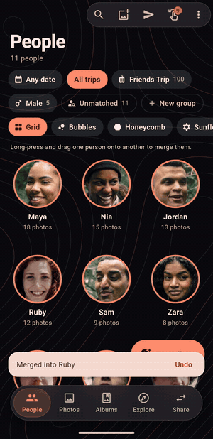</td>
    <td align="center" width="25%">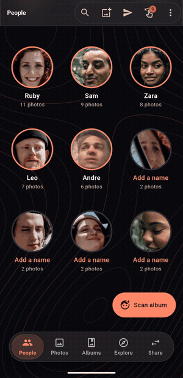</td>
    <td align="center" width="25%">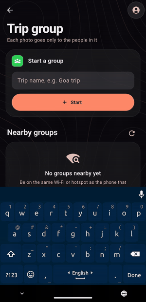</td>
    <td align="center" width="25%">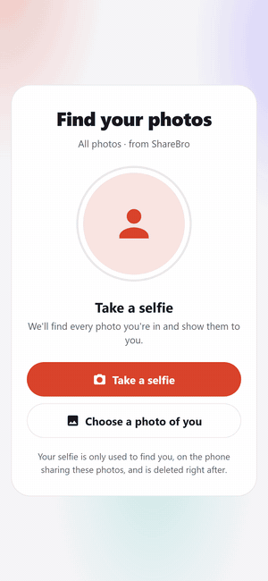</td>
  </tr>
  <tr>
    <td align="center"><b>People views</b><br><sub>Grid, Honeycomb, Bubbles</sub></td>
    <td align="center"><b>Fix a split</b><br><sub>Drag one person onto another</sub></td>
    <td align="center"><b>Trip group</b><br><sub>Friends join with a code</sub></td>
    <td align="center"><b>Find my photos</b><br><sub>A friend's browser, no app</sub></td>
  </tr>
</table>

<sub>Every screenshot and clip here is the current app on a Pixel 7 Pro, with a
demo trip of free stock photos from Pexels: the people are models and the
names are made up. The last clip is the web page a friend sees after scanning
the QR code.</sub>

## Highlights

| | |
|---|---|
| 👥 **Face grouping** | On-device face detection and recognition, tuned to cope with glasses, angles and lighting |
| 🧳 **Trip groups** | Everyone joins with a 4-digit code; each photo goes only to the people in it |
| 🔎 **Find my photos** | Friends scan a QR code, take a selfie in their browser, and get a gallery of just their photos |
| 📤 **LocalSend-compatible** | Send photos, videos, files, folders, text and apps to any device running LocalSend (Android, iPhone, Windows, Mac, Linux) |
| 📡 **No network needed** | ShareBro phones can send to each other over Bluetooth and Wi-Fi Direct |
| 🗺️ **Places and Journey** | Your photos on a map, and the whole trip replayed like a travel video |
| 🖼️ **A full gallery** | Photos and videos, albums, favourites, trash, duplicates and best shots |
| 🔒 **Private by design** | Works fully offline; transfers are encrypted; optional app lock |

---

## Features in detail

### 👥 People

<p align="center">
  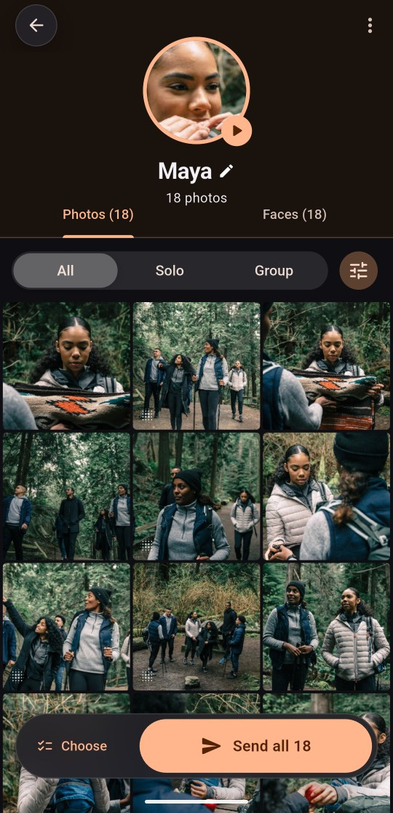
  &nbsp;
  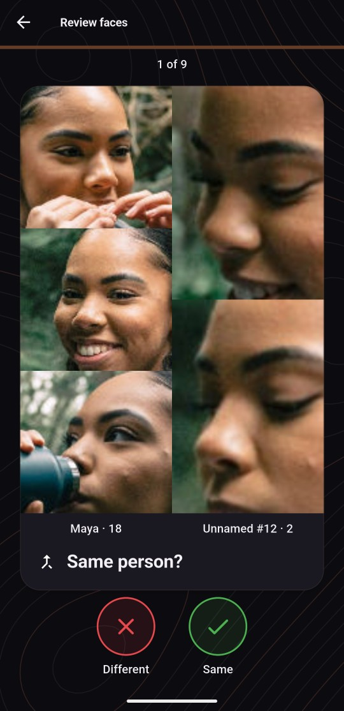
</p>

- **Automatic face grouping.** Every face in the scanned photos is detected,
  turned into a fingerprint, and grouped with the faces of the same person.
- **Several looks per person.** A person can be recognised with and without
  glasses, with a new haircut, or at different ages, without being split
  into separate people.
- **Grouping strictness** (Settings): slide towards *Loose* to put more faces
  together, or *Strict* to keep groups clean. A live estimate shows how many
  people you'd get. Named people and faces you fixed by hand never change.
- **Name, merge and split.** Long-press and drag one person onto another to
  merge them. Move single photos out of a person, or split off a whole group
  of faces.
- **Review.** ShareBro asks about faces it's unsure of ("Is this Maya?").
  Matches it's very sure of (75%+) are added automatically.
- **Unmatched faces.** Half-turned, partly hidden or blurry faces that
  couldn't be placed are collected in one screen, where you can move them to
  the right person by hand.
- **"Not [name]".** Remove wrong faces from a person in one tap; Undo brings
  them all back.
- **Hide people.** "Not in our group" hides strangers in the background of
  your photos, and Settings lets you bring them back.
- **Person groups.** Save groups like "College friends" to filter People
  and send to several people at once.
- **Clearest-face pictures.** Each person's picture is their sharpest, most
  front-facing face, and it changes from time to time in the grid.
- **Male / Female.** An on-device guess for each person, used as a filter and
  in search. You can correct it per person.
- **Views.** A grid, or Bubbles, Honeycomb and Sunflower views where bigger
  faces mean more photos.
- **Profile.** Set your own face once, from a selfie, uploaded photos or
  yourself in People. Trip groups use it to know who you are.

### 🧳 Trips

- **A trip per album or folder.** Scan a phone album (Camera, WhatsApp
  Images…), any folder you choose, or everything, optionally limited to a
  date range.
- **Trip timeline and days.** A trip is split into days, each named after
  what stands out ("Day 2 · Beach", "Day 3 · Mountains").
- **Auto-scan.** New photos in an album you've scanned are picked up and
  scanned automatically.
- **Only new photos are processed.** Each photo is scanned once. Scanning
  the same folder again skips everything already done, so a repeat scan is
  quick.
- **Background scanning.** Scans keep going with the screen off, with
  progress in the notification shade (see [Notifications](#-notifications)).

### 🖼️ Gallery

<p align="center">
  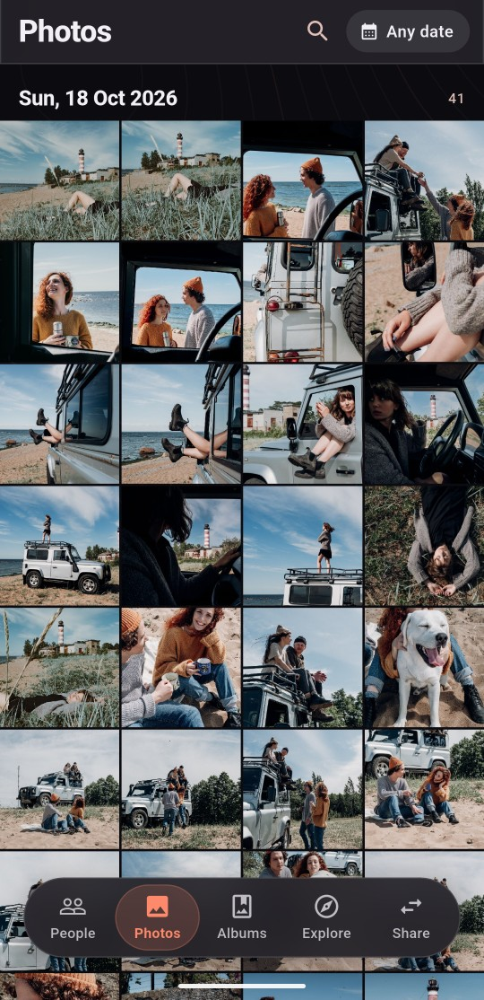
  &nbsp;
  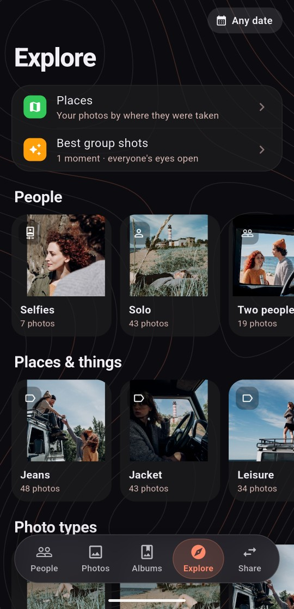
</p>

- **Photos and videos** by day, newest first. Pinch with two fingers to
  change the grid size; drag the date scrubber on the right to jump through
  time.
- **Select by dragging.** Press and hold a photo, then drag to select a
  range, or select a whole day with one tap.
- **Actions:**
  - **Send:** to a nearby device, by link, or to other apps;
  - **Favourite:** add or remove the heart (Android 11+);
  - **Album:** copy or move into an existing or new album;
  - **Delete:** move to the phone's trash, with Undo.
- **Viewer.** Swipe between photos, pinch or double-tap to zoom, play videos
  with a seek bar, tap a face to spotlight that person, pull up for details
  (date, camera, size, location, the people in the photo).
- **Smart albums:**
  - **Favourites:** everything with a heart;
  - **Videos:** all your videos;
  - **Trash:** everything deleted, with the days left before it's gone for
    good; restore it or delete it forever (Android 11+).
- **Fast.** Thumbnails come from Android's own stored previews, are sized to
  the grid, and stay cached, so scrolling stays smooth even with tens of
  thousands of photos.

### 🧭 Explore

- **Places.** Every photo with a location on a map: pins that split apart as
  you zoom in, and a card for each place listing what most of its photos
  show. Choose a drawn map that works fully offline, or a real
  OpenStreetMap map (needs internet for the map itself).
- **Journey.** The trip replayed in order like a travel video, with an
  automatic camera you can take over by hand. Filter by dates.
- **Best group shots.** Bursts of group photos taken seconds apart, with the
  best one picked: everyone's eyes open, sharp, smiling.
- **Clean up duplicates.** Near-identical photos grouped, with the best copy
  kept and the rest marked for deletion.
- **Categories.** Selfies, groups, scenery, screenshots, WhatsApp, Telegram,
  eyes closed, blurry and many scene types (beach, food, mountains…), found
  automatically.

### 🔎 Search

Type naturally, for example *"Maya beach June 2026"* or *"women
mountains"*. Search understands people, trips, categories and scenes,
male / female, and dates, and combines them.

### 📤 Share

ShareBro speaks the open **[LocalSend](https://localsend.org)** protocol,
so it works with the free LocalSend app on Android, iPhone, Windows, macOS
and Linux, as well as with other ShareBro phones.

<p align="center">
  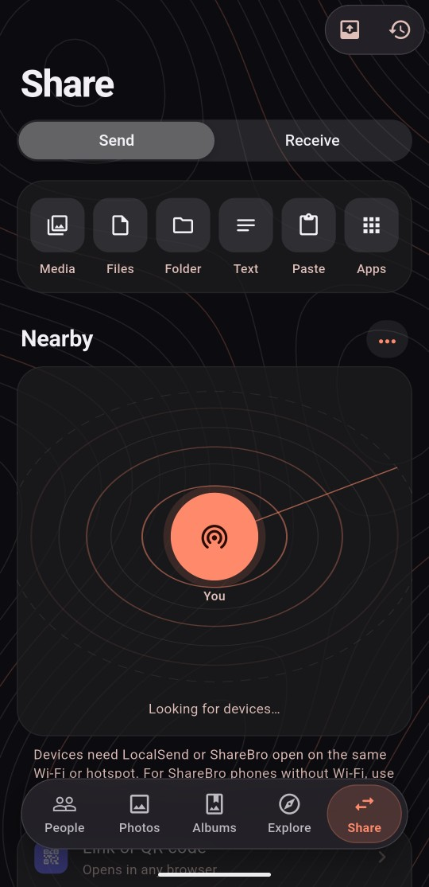
  &nbsp;
  
</p>

**Send:**
- **What:** photos and videos, files, whole folders (the folder layout is
  kept), typed text, the clipboard, and **installed apps** (as `.apk`; apps
  installed in parts are sent as a folder of parts, installable with an app
  like [SAI](https://github.com/Aefyr/SAI)).
- **To whom:**
  - **Nearby devices on the same Wi-Fi or hotspot,** found automatically.
    Long-press a device to make it a favourite, rescan the network, or
    connect by IP address if a device doesn't show up.
  - **ShareBro phones with no network at all,** using Nearby Connections
    over Bluetooth and Wi-Fi Direct.
  - **Anyone with a browser,** via a **Link / QR code**. They get a private
    web gallery with full-screen viewing, a slideshow and ZIP download.
  - **Other apps,** through Android's share sheet.
- **Quality:** send originals, originals without location and camera
  details, or smaller copies that send faster.
- **Send to everyone.** Every named friend whose phone you've paired gets
  the photos they don't have yet, in one tap. Friends who aren't nearby wait
  in a queue and start automatically when their phone shows up.

**Trip groups:**

<p align="center">
  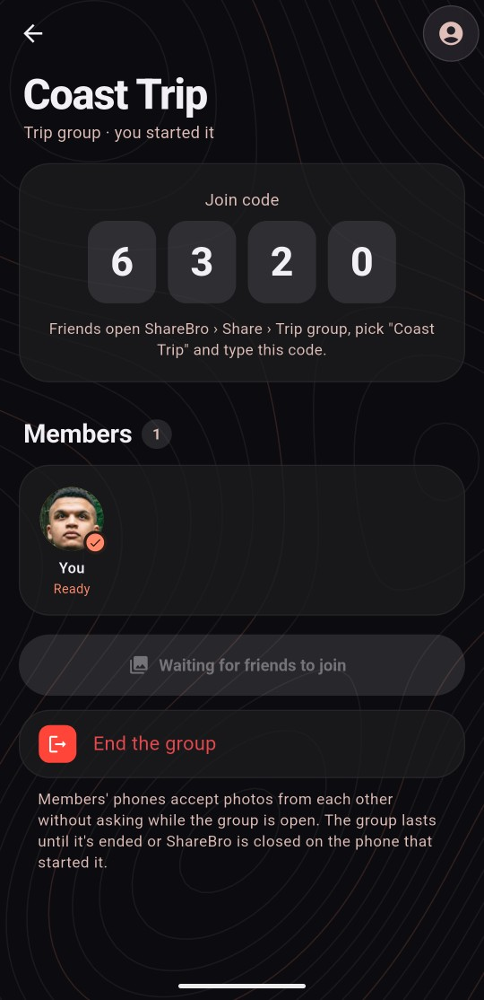
</p>

- One person starts a group and everyone else joins with a **4-digit code**.
- Each member's face (from their Profile) is matched against the photos you
  pick, so **each photo goes only to the members in it**. If a match is
  uncertain, you're asked.
- Photos nobody else in the group is in stay on your phone.

**Find my photos:**

<p align="center">
  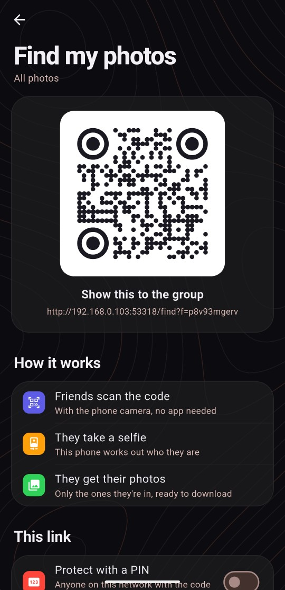
  &nbsp;
  
  &nbsp;
  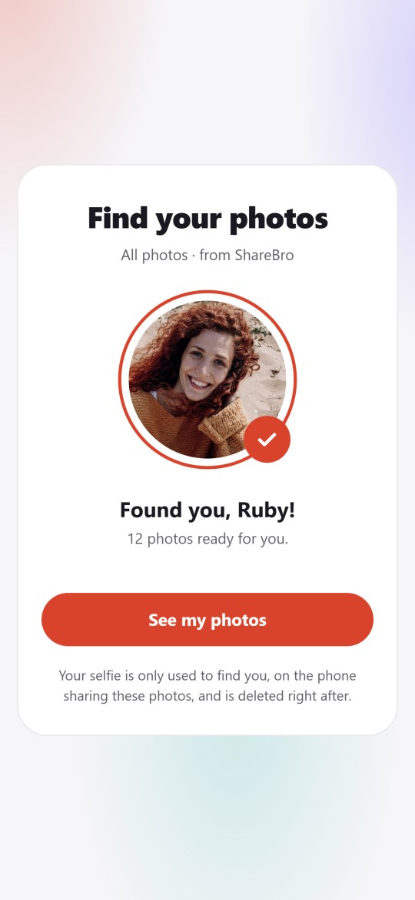
  &nbsp;
  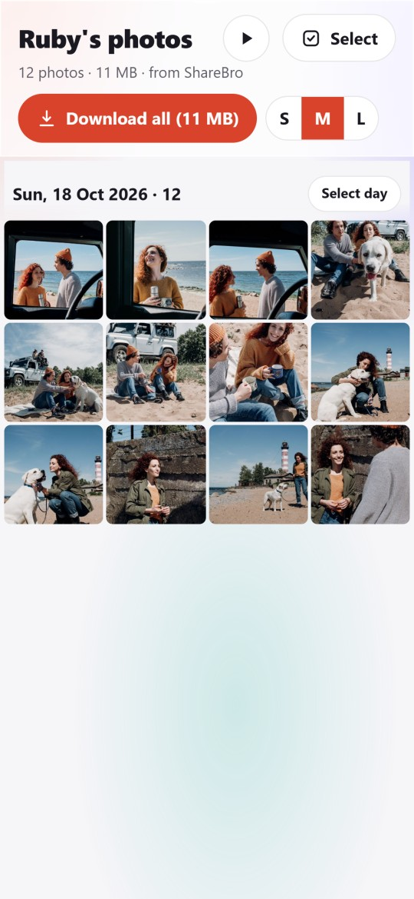
</p>
<p align="center"><sub>Your phone shows the code · the friend takes a selfie in their browser · they're found · their own gallery</sub></p>

- One QR code for the whole group. Each friend scans it, takes a selfie (or
  picks one) **in their browser**, and lands on a gallery of just the photos
  they're in.
- Their face is matched on your phone; no app is needed on theirs.

**Receive:**
- **Ready to receive:** shows your device name and address.
  - **Quick save:** accept everything without asking.
  - **Auto-accept favourites:** favourite and paired devices skip the
    question.
  - **PIN:** senders have to enter a code first.
- **Accept / Decline** whenever ShareBro is open, even with Receive switched
  off. With Receive on, you can also answer from a notification while the
  app is in the background.
- **Where things go:**
  - photos and videos: the **ShareBro** album, where they're scanned for
    faces;
  - other files: **Download/ShareBro**;
  - received apps: open Android's installer from History;
  - text messages: pop up with a Copy button.

**Live transfers and history:**
- A live screen shows your phone and theirs with the files moving between
  them, plus speed, time left and every file ticking off.
- A **History** of everything sent and received. Tap an item to open it,
  swipe to remove it.

### 🔔 Notifications

- **The island.** A pill at the top of the app shows sending, receiving,
  scanning and incoming requests, with Accept / Decline right inside it. Tap
  it for details. Turn it off in Settings if you prefer popups.
- **Rich Android notifications:**
  - **Progress:** a thumbnail, speed and time left, with **Cancel**;
  - **Requests:** **Accept / Decline** buttons;
  - **Received:** a photo grid preview when it's done;
  - **Scan results:** with **Retry**;
  - **Android 16:** Live Update progress chips in the status bar.
- **Separate notification categories,** so you can silence one without
  losing the others.

### ⚙️ Settings and safety

- **Profile:** your own face, for trip groups.
- **Grouping strictness:** how readily faces are put together.
- **Theme:** System, Light or Dark.
- **Default send quality:** originals, no location, or smaller.
- **Auto-scan new photos.**
- **App lock:** fingerprint, face or screen lock to open the app.
- **Island at the top:** on or off.
- **Storage:** space used by trips, duplicates and screenshots.
- **Not in our group:** people you've hidden.
- **Back up and restore:** names, faces, trips and groups saved to one
  file (not the photos themselves).
- **Clear all face data:** start over; your photos aren't affected.
- **About:** the developer, with links to this repository.

---

## Install

1. Open the **[latest release](https://github.com/Yeamin-Talukder/ShareBro/releases/latest)**
   on your phone.
2. Download the APK for your phone:

   | File | For |
   |---|---|
   | **`ShareBro-…-arm64-v8a.apk`** | **Almost every phone from the last ~7 years.** Start with this one. |
   | `ShareBro-…-armeabi-v7a.apk` | Older 32-bit phones |
   | `ShareBro-…-x86_64.apk` | Emulators and Chromebooks |

3. Open the downloaded file. If Android asks, allow **"Install unknown
   apps"** for your browser or file manager.
4. Open ShareBro, allow photo access, and tap **Scan** to scan your first
   trip.

**Updating:** install the newer APK over the old one. Your people, names
and settings are kept.

**Checking a download:** each release includes `SHA256SUMS.txt` with the
checksum of every APK.

---

## How it works

### Recognising faces

```
photo ─► Google ML Kit ─► face found ─► aligned 112×112 crop ─► InsightFace MobileFaceNet ─► 512-number fingerprint
                                                                                                     │
           People ◄── one group per person (several "looks" each) ◄── clustering ◄───────────────────┘
```

1. **Detection.** Google ML Kit finds faces and reports eye positions,
   smiles, eyes open and head angle. Faces that are too small or turned too
   far away are skipped.
2. **Alignment.** Each face is cropped and rotated so the eyes land on the
   standard ArcFace template (112 × 112 pixels).
3. **Fingerprint.** InsightFace's MobileFaceNet (trained on WebFace600K,
   running on TensorFlow Lite) turns the crop into 512 numbers. Faces of the
   same person get similar numbers, even with glasses or at a different
   angle.
4. **Grouping.** Fingerprints are clustered into people. A person can have
   several "looks" (clusters), so one person isn't split in two.
   Look-alikes are suggested for merging rather than merged automatically.
5. **Tags.** Each photo also gets scene labels (ML Kit image labelling),
   face statistics (selfie, group, eyes closed, blurry), a duplicate
   fingerprint and its location, which power Explore and Search.

Scanning runs on several photos at once in a background worker, reads
downscaled copies from Android rather than full images, and remembers every
photo it has done.

### Storing data

A local SQLite database holds faces (fingerprints and small crops), people,
trips, tags, devices, groups and transfer history. **Photos stay in the
phone's own photo library.** ShareBro refers to them by their gallery ID and
never copies them.

### Sharing

```
Send ─► LocalSend protocol v2 (HTTPS, mutual TLS, pinned certificates) ─► any LocalSend device
     ├─► Nearby Connections (Bluetooth / Wi-Fi Direct)                  ─► ShareBro phones
     └─► built-in web server + QR code                                  ─► any browser
```

- **Discovery:** UDP multicast on `224.0.0.167:53317`, answered with
  `POST /register`. If multicast is blocked, there's a subnet scan and
  manual IP entry as fallbacks.
- **Transfers:** `prepare-upload` (the receiver accepts or declines), then
  one `upload` per file, two files at a time. Failed uploads retry on a
  fresh connection.
- **Security:**
  - Each phone has its own TLS certificate, and its fingerprint is the
    SHA-256 of that certificate.
  - Both sides present certificates (mutual TLS), as current LocalSend
    versions require.
  - Each side checks that the other's certificate matches the fingerprint
    it announced.
- **Web links** (Link / QR, Find my photos): a separate local web server on
  port `53318`, reachable only on your Wi-Fi or hotspot.
- **Trip groups:** ShareBro's own API on the same HTTPS server.

Everything runs in a foreground service, so transfers and scans keep going
when you switch apps or turn the screen off.

---

## Privacy and security

- **Your photos never leave your phone** unless you send them to someone.
  Nothing is uploaded to any server; there are no accounts, ads or
  analytics.
- **Face data stays on the phone.** That's fingerprints and small face
  crops, in the app's private storage.
- **Transfers are encrypted** (HTTPS with mutual TLS), and devices are
  identified by certificate fingerprints that can't be faked.
- **Nothing is saved without your say-so** unless you turn on Quick save or
  auto-accept, and you can require a PIN.
- **Web links only work on your local network** and stop when you stop
  sharing.
- **The only internet use** is the optional real map in Places, which loads
  map tiles from OpenStreetMap.
- **Backups contain face data.** Keep backup files private.

## Android version support

| Feature | Needs |
|---|---|
| The app | Android 9 (API 28) or newer |
| Favourites, Trash (restore / delete forever) | Android 11+ |
| Live Update chip in the status bar | Android 16+ |
| Nearby sending (no network) | Bluetooth and location turned on |

Developed and tested on a **Pixel 7 Pro** (Android 16).

### Permissions

| Permission | Why |
|---|---|
| Photos and videos | Find faces and show your gallery (it only changes things when you delete, move or favourite) |
| Photo locations | Show photos on the Places map |
| Notifications | Progress, incoming requests, finished transfers |
| Wi-Fi, multicast, local network | Find and talk to nearby devices |
| Bluetooth / nearby devices | Send with no network (Nearby Connections) |
| Foreground service | Keep scans and transfers going in the background |
| Install packages | Install apps that friends send you (Android asks every time) |
| Camera (through the system picker) | Take a selfie for your profile |
| Biometrics | Optional app lock |

---

## Build from source

### Requirements

- [Flutter](https://docs.flutter.dev/get-started/install) **3.47+** (Dart 3.13)
- Android SDK with **API 36** (compile SDK)
- An Android phone or emulator running Android 9 or newer

### Run

```bash
git clone https://github.com/Yeamin-Talukder/ShareBro.git
cd ShareBro
flutter pub get
flutter run
```

### Release build

One APK per processor type (about 80 MB for modern phones, instead of one
150 MB universal APK):

```bash
flutter build apk --release --split-per-abi --split-debug-info=build/symbols
```

The APKs are written to `build/app/outputs/flutter-apk/`.

> **Notes**
> - Code shrinking (R8) is turned **off** on purpose: it breaks ML Kit's
>   face detection in release builds.
> - Release builds are signed with the debug key for now. Use your own
>   signing key before publishing anywhere else.

### Tests and checks

```bash
flutter analyze
flutter test
```

The tests cover face tagging and grouping, duplicates, the LocalSend
protocol, mutual TLS, recovery from dropped connections, the receive flow,
the transfer screens, the island, thumbnails, trash and app sending.

### Regenerating the icon

`tool/make_icon.py` draws the icon and writes every version of it: the
adaptive, themed and status-bar vectors, the launcher PNGs, and the
Windows icon.

---

## Project structure

```
lib/
├── main.dart              App start, theme, island, notification bridge
├── data/                  Database and everything stored or read
│   ├── db.dart            SQLite schema and queries
│   ├── gallery.dart       Reading the phone's photo library
│   ├── profile.dart       Your own face (for trip groups)
│   ├── places.dart        Grouping photos into places
│   ├── search.dart        Understanding search queries
│   ├── trip_days.dart     Splitting a trip into named days
│   ├── group_shots.dart   Finding the best photo of each burst
│   ├── group_match.dart   Who gets which photo in a trip group
│   ├── duplicates.dart    Near-identical photos
│   ├── trash.dart         The phone's trash
│   ├── apps.dart          Installed apps, for sending
│   └── backup.dart        Back up and restore
├── face/                  Face recognition
│   ├── face_engine.dart   Detection, alignment, fingerprints (background worker)
│   ├── clustering.dart    Grouping fingerprints into people
│   ├── gender.dart        Male / female guess
│   └── tags.dart          Scene labels and photo categories
├── scan/                  Scanning, auto-scan and background work
├── share/                 Sending and receiving
│   ├── protocol.dart      LocalSend protocol v2 messages
│   ├── tls.dart           This phone's certificate
│   ├── client.dart        HTTPS client with mutual TLS
│   ├── discovery.dart     Finding nearby devices
│   ├── sender.dart        Sending to LocalSend devices
│   ├── server.dart        Receiving, web links, trip-group API
│   ├── receive.dart       Accepting and saving incoming files
│   ├── nearby.dart        Sending with no network
│   ├── group.dart         Trip groups
│   ├── find_page.dart     The "Find my photos" web page
│   ├── web_page.dart      The shared-link web gallery
│   ├── send_center.dart   The queue of sends
│   └── notify.dart        Rich Android notifications
└── ui/                    Screens and widgets

android/app/src/main/kotlin/…   Native helpers: files, trash, thumbnails,
                                installed apps, notifications
assets/models/                  Face recognition and gender models (TFLite)
assets/icon/                    App icon
design/                         HTML design demos
docs/                           Logo, screenshots, clips and the promo video for this README
test/                           Unit and widget tests
tool/                           Icon generator
```

## Tech stack

| Area | What's used |
|---|---|
| App | Flutter 3.47, Dart 3.13, Material 3 |
| Face detection | Google ML Kit (`google_mlkit_face_detection`) |
| Face recognition | InsightFace MobileFaceNet (w600k_mbf) on TensorFlow Lite (`tflite_flutter`) |
| Scene labels | Google ML Kit image labelling |
| Photo library | `photo_manager`, plus native Android code for thumbnails and trash |
| Database | SQLite (`sqflite`) |
| Sharing | Own Dart implementation of LocalSend protocol v2, `basic_utils` (certificates), `crypto` |
| No-network sending | `nearby_connections` |
| Maps | `flutter_map` with OpenStreetMap tiles, and a drawn offline map |
| Background work | `flutter_foreground_task` |
| Other | `flutter_animate`, `video_player`, `file_picker`, `image_picker`, `qr_flutter`, `share_plus`, `local_auth` |

---

## Troubleshooting

<details>
<summary><b>Nearby devices don't show up</b></summary>

- Both devices must be on the **same Wi-Fi or hotspot**. Some public or
  office networks block devices from seeing each other ("client
  isolation"); a phone hotspot always works.
- Tap the **rescan** button to search the whole network, or use **connect
  by address** with the IP shown on the other device's Receive screen.
- For ShareBro to ShareBro with no network, tap the **Bluetooth** button
  and turn on Receive on the other phone.
</details>

<details>
<summary><b>"… closed the connection" when sending to LocalSend</b></summary>

Current LocalSend versions require both sides to show a certificate.
ShareBro does this from **v1.0.0** onwards, so update ShareBro. Also check
that LocalSend's receive server is running on the other device.
</details>

<details>
<summary><b>The other phone never sees Accept / Decline</b></summary>

- If ShareBro is **open** on that phone, it always asks (v1.0.2+).
- If it's **closed or in the background**, turn on **Receive** in the Share
  tab so it can answer from a notification.
- If **Quick save** or **Auto-accept favourites** is on, matching sends are
  accepted without asking, by design.
</details>

<details>
<summary><b>LocalSend and ShareBro on the same phone</b></summary>

Both apps use network port 53317, and whichever starts first gets it. While
ShareBro is running, LocalSend on the same phone can't receive (and the
other way round). Close one app while you use the other.
</details>

<details>
<summary><b>Scanning the same folder again</b></summary>

Photos that were already scanned are skipped instantly, so only new photos
take time. The counter still counts through every photo.
</details>

<details>
<summary><b>A received app won't install</b></summary>

Apps installed from the Play Store in parts (app bundles) arrive as a
folder of `.apk` files. Install them together with an app like
[SAI](https://github.com/Aefyr/SAI). Single `.apk` files install directly
from History.
</details>

---

## Release history

| Version | Highlights |
|---|---|
| [**v1.3.0**](https://github.com/Yeamin-Talukder/ShareBro/releases/tag/v1.3.0) | InsightFace face model: much better matching with glasses and angles; review adds sure matches automatically; "Not [name]" |
| [v1.2.0](https://github.com/Yeamin-Talukder/ShareBro/releases/tag/v1.2.0) | Places map and Journey, male / female filters, Unmatched faces, faster scans and thumbnails, new notifications |
| [v1.1.0](https://github.com/Yeamin-Talukder/ShareBro/releases/tag/v1.1.0) | Trip groups, Profile, Find my photos, Search, best group shots, trip days, new design and icon |
| [v1.0.2](https://github.com/Yeamin-Talukder/ShareBro/releases/tag/v1.0.2) | Accept / Decline whenever the app is open; darker background |
| [v1.0.1](https://github.com/Yeamin-Talukder/ShareBro/releases/tag/v1.0.1) | About section with the developer's links |
| [v1.0.0](https://github.com/Yeamin-Talukder/ShareBro/releases/tag/v1.0.0) | First release: face grouping, gallery, LocalSend-compatible sharing, app sending, trash, island |

## Known limitations

- **Android only.** The iOS and Windows folders are Flutter scaffolding and
  aren't tested.
- **Signed with a development key.** If a future release switches to a
  proper key, ShareBro will need to be uninstalled once before updating
  (back up first in Settings).
- **The face recognition model is for non-commercial use** (see
  [Credits](#credits-and-third-party-licences)).
- **Face recognition can make mistakes,** especially with babies, twins,
  heavy make-up or very small faces. Check the People groups before sending
  to everyone.

## Contributing

Bug reports and ideas are welcome. Please
**[open an issue](https://github.com/Yeamin-Talukder/ShareBro/issues)**
with what you did, what you expected, and your phone and Android version.
Screenshots help, but please don't post photos of other people's faces.

Before sending a pull request, run `flutter analyze` and `flutter test`.

## Developer

<table>
  <tr>
    <td align="center">
      <a href="https://github.com/Yeamin-Talukder">
        <br>
        <b>Md Yeamin Talukder</b>
      </a>
    </td>
    <td>
      Designed and built ShareBro.<br><br>
      🧑‍💻 GitHub: <a href="https://github.com/Yeamin-Talukder">@Yeamin-Talukder</a><br>
      📦 Repository: <a href="https://github.com/Yeamin-Talukder/ShareBro">github.com/Yeamin-Talukder/ShareBro</a><br>
      🐞 Found a bug or have an idea? <a href="https://github.com/Yeamin-Talukder/ShareBro/issues">Open an issue</a>
    </td>
  </tr>
</table>

## Credits and third-party licences

- **[LocalSend](https://github.com/localsend/localsend):** ShareBro
  implements its open protocol ([Apache-2.0](https://github.com/localsend/protocol))
  so it can exchange files with the official LocalSend apps. ShareBro is not
  affiliated with LocalSend.
- **[InsightFace](https://github.com/deepinsight/insightface):** the
  face-recognition model (`w600k_mbf`, MobileFaceNet trained on
  WebFace600K), converted to TensorFlow Lite. InsightFace's pretrained
  models are licensed for **non-commercial research use only**.
- **Gender model:** from
  [shubham0204/Age-Gender_Estimation_TF-Android](https://github.com/shubham0204/Age-Gender_Estimation_TF-Android)
  (MIT).
- **[GeoNames](https://www.geonames.org) (CC BY 4.0):** the offline place
  names used to search photos by town or country (every town with 500+
  people worldwide, plus every village and landmark in Bangladesh). Built
  with `tool/make_places.py`.
- **[Google ML Kit](https://developers.google.com/ml-kit):** face detection
  and image labelling, under Google's ML Kit terms.
- **[OpenStreetMap](https://www.openstreetmap.org/copyright):** map tiles in
  the real-map view, © OpenStreetMap contributors (ODbL).
- Built with **Flutter** and the open-source packages listed in
  [Tech stack](#tech-stack).
- **Demo photos** in the screenshots, clips and video: free stock photos
  from [Pexels](https://www.pexels.com/license/) by
  [cottonbro studio](https://www.pexels.com/@cottonbro) and
  [PNW Production](https://www.pexels.com/@pnw-prod). The people are models;
  the names are made up.
- **Promo video:** voice by [Kokoro](https://huggingface.co/hexgrad/Kokoro-82M)
  (Apache-2.0); music and sound effects made from scratch.

## License

No license has been chosen yet, so all rights are reserved by
**Md Yeamin Talukder**. You're welcome to read the code and build it for
yourself. Please ask before reusing it.

Third-party components keep their own licences (see above). In particular,
the InsightFace model restricts use to non-commercial purposes.
