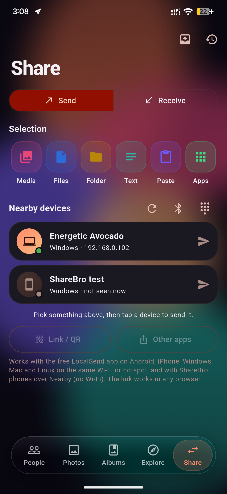
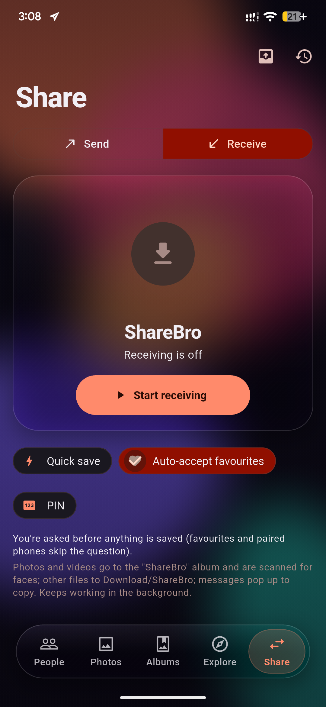
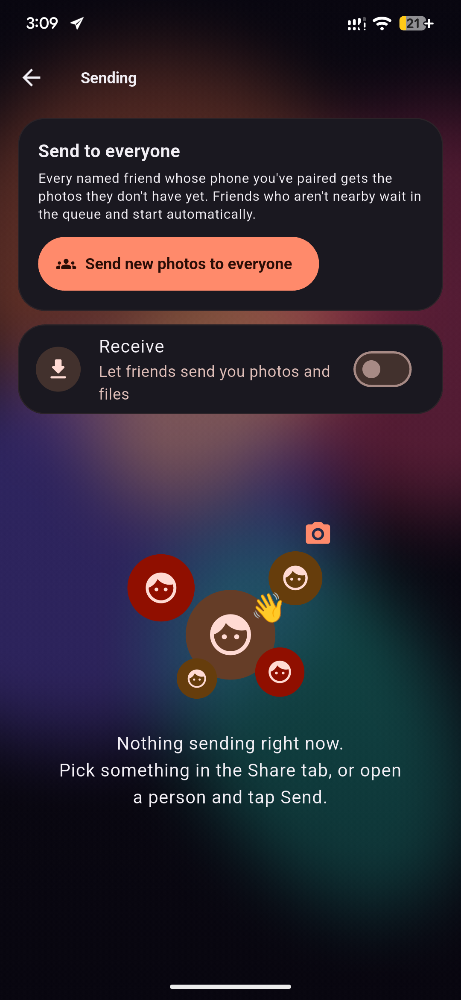
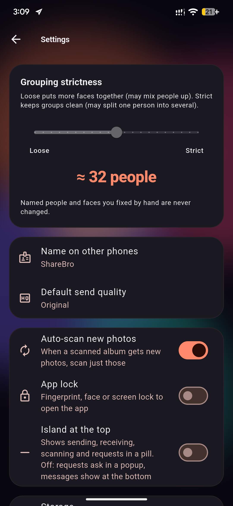

<div align="center">


# ShareBro

**Your trip photos, sorted by face — and sent to every friend in a tap.**

<sub>Made by <a href="https://github.com/Yeamin-Talukder"><b>Md Yeamin Talukder</b></a></sub>

[](https://github.com/Yeamin-Talukder/ShareBro/releases/latest)
[](https://github.com/Yeamin-Talukder/ShareBro/releases)
[](https://github.com/Yeamin-Talukder/ShareBro)
[](https://github.com/Yeamin-Talukder/ShareBro/stargazers)
<br>


ShareBro is an offline Android app for the friend who takes all the photos.
It finds every face in your gallery, groups the photos by person, and sends
each friend their own photos straight to their phone. No cloud, no uploads,
no accounts.

### [⬇️ Download the latest APK](https://github.com/Yeamin-Talukder/ShareBro/releases/latest)

<sub>Most phones: <code>ShareBro-…-arm64-v8a.apk</code> · Android 9 or newer</sub>

</div>

## Screenshots

<p align="center">
  
  &nbsp;
  
  &nbsp;
  
  &nbsp;
  
</p>

<p align="center">
  <sub><b>Share</b> — photos, files, folders, text or apps to any nearby device &nbsp;·&nbsp;
  <b>Receive</b> — quick save, auto-accept, PIN &nbsp;·&nbsp;
  <b>Sending</b> — everyone gets their own photos &nbsp;·&nbsp;
  <b>Settings</b> — grouping strictness and more</sub>
</p>

<p align="center"><sub>The People and Photos screens aren't shown here because they'd show real people's faces.</sub></p>

---

## Why

After a group trip you have 5,000 photos and ten friends who each want
*their* photos. ShareBro scans the trip once, shows you a page per person,
and sends the right photos to the right phone — over Wi-Fi, a hotspot, or
with no network at all.

Everything happens **on the phone**. Photos are never copied, moved or
uploaded: ShareBro only keeps references to them, like shortcuts.

## Features

### 👥 People
- **Face grouping:** on-device face detection (Google ML Kit) and face
  recognition (MobileFaceNet), so every person gets their own page.
- **Handles lots of looks:** people are matched across lighting, angles,
  glasses and haircuts, with suggestions to merge look-alikes.
- **Name and pair:** name people, review uncertain faces, split or merge
  groups, hide people you don't care about.
- **Best shots:** smiling, eyes open, sharpness and duplicate detection
  pick out the keepers.
- **Trips and dates:** scan one album, one folder, or a date range.
  New photos are picked up automatically.
- **Explore:** selfies, groups, scenery, screenshots, WhatsApp, Telegram
  and more, tagged automatically.

### 🖼️ Gallery
- **Everything in one place:** all photos and videos by day, with pinch to
  change the grid size and a fast date scrubber.
- **Select and act:** press and drag to select, then send, share,
  favourite, copy or move to an album, or delete.
- **Smart albums:** Favourites, Videos, and **Trash**, where you can
  restore or permanently delete items (Android 11+).
- **Viewer:** a full-screen photo and video viewer with zoom, swipe, face
  spotlight, info panel and video playback.

### 📤 Share (LocalSend-compatible)
- **Send anything:** photos, videos, files, whole folders, text or the
  clipboard to any device running
  [LocalSend](https://localsend.org) (Android, iOS, Windows, macOS,
  Linux) on the same Wi-Fi or hotspot.
- **No network needed:** ShareBro phones can also send to each other with
  no network at all, using Nearby Connections over Bluetooth and Wi-Fi
  Direct.
- **Link / QR:** anyone with a browser downloads from a private web
  gallery, with full-screen viewing, slideshow and ZIP download.
- **Receive mode:** quick save, a PIN, auto-accept for favourites, and
  received photos scanned for faces automatically.
- **Live transfers:** an animated transfer screen with speed and time left,
  and a full history of everything sent and received.
- **Privacy options:** send originals, strip location data, or send
  smaller copies.

### 🔔 Notifications
- **Dynamic Island-style pill:** a pill at the top of the app shows sends,
  receives, scans and incoming requests, with Accept / Decline right
  inside it.
- **Rich Android notifications:** progress, thumbnails and Accept /
  Decline / Cancel buttons, plus the **Android 16 Live Update** progress
  chip in the status bar.

### ✨ Feel
- **Look:** a glass-style UI, an animated liquid-gradient background, and
  smooth gestures and haptics.
- **Privacy:** an app lock (fingerprint or face), light and dark mode, and
  a backup and restore of all face data.

## How it works

```
Gallery ──► ML Kit face detection ──► MobileFaceNet embeddings ──► clustering ──► People
   │                                                                              │
   └──────── nothing is copied: photos are referenced by id ──────────────────────┘

Send ──► LocalSend protocol v2 (HTTPS, pinned certificate)  ──► any LocalSend device
     ├─► Nearby Connections (Bluetooth / Wi-Fi Direct)      ──► ShareBro phones
     └─► built-in web server + QR code                      ──► any browser
```

- **Faces:** detected with ML Kit, cropped and aligned, then turned into
  128-number "fingerprints" by MobileFaceNet (TensorFlow Lite, running in a
  background isolate) and grouped with a clustering pass that supports
  several looks per person.
- **Data:** a local SQLite database (faces, people, trips, tags, devices,
  transfer history). Photos stay in the phone's library.
- **Sharing:** a from-scratch Dart implementation of the
  [LocalSend protocol v2](https://github.com/localsend/protocol), with its
  own TLS identity, multicast discovery and subnet scan.

## Getting started

### Requirements
- [Flutter](https://docs.flutter.dev/get-started/install) **3.47+**
  (Dart 3.13)
- An Android phone or emulator running **Android 9 (API 28)** or newer
- For Trash and favourites: Android 11+. For Live Updates: Android 16.

### Run it

```bash
git clone https://github.com/Yeamin-Talukder/ShareBro.git
cd ShareBro
flutter pub get
flutter run
```

### Build a release APK

One APK per processor type (about 80 MB for modern phones, instead of one
150 MB universal APK):

```bash
flutter build apk --release --split-per-abi --split-debug-info=build/symbols
```

The APKs land in `build/app/outputs/flutter-apk/`. Most phones today need
`app-arm64-v8a-release.apk`.

> Release builds are signed with the debug key for now. Set up your own
> signing key before publishing anywhere.

### Tests

```bash
flutter analyze
flutter test
```

## Project layout

```
lib/
├── data/       SQLite database, gallery access, trash, duplicates, backup
├── face/       face detection, embeddings, clustering, tags
├── scan/       scanning, auto-scan and background work
├── share/      LocalSend protocol, sender, receiver, Nearby, web server, notifications
└── ui/         screens and widgets (gallery, people, share, island, viewer…)
android/app/src/main/kotlin/…   native helpers: files, trash, notifications
assets/models/  MobileFaceNet face-recognition model (TensorFlow Lite)
design/         HTML design demos (backgrounds, notifications, premium look)
docs/           logo and screenshots for this README
test/           unit and widget tests
tool/           app-icon generator
```

## Permissions

| Permission | Why |
|---|---|
| Photos and videos | To find faces and show your gallery (read-only unless you delete or move) |
| Notifications | Transfer and scan progress, incoming requests |
| Wi-Fi, multicast, Internet (local network only) | Finding and talking to nearby devices |
| Bluetooth / Nearby devices | Sending with no network (Nearby Connections) |
| Foreground service | Keep scanning and transfers going in the background |
| Biometrics | Optional app lock |

Nothing is ever sent to a server. The "Internet" permission is only used on
your local network.

## Status

ShareBro is a personal project and is developed and tested on **Android**
(Pixel 7 Pro). The iOS and Windows folders are Flutter scaffolding and are
not tested yet.

## Developer

<table>
  <tr>
    <td align="center">
      <a href="https://github.com/Yeamin-Talukder">
        <br>
        <b>Md Yeamin Talukder</b>
      </a>
    </td>
    <td>
      Designed and built ShareBro.<br><br>
      🧑‍💻 GitHub: <a href="https://github.com/Yeamin-Talukder">@Yeamin-Talukder</a><br>
      📦 Repository: <a href="https://github.com/Yeamin-Talukder/ShareBro">github.com/Yeamin-Talukder/ShareBro</a><br>
      🐞 Found a bug or have an idea? <a href="https://github.com/Yeamin-Talukder/ShareBro/issues">Open an issue</a>
    </td>
  </tr>
</table>

## Credits

- **[LocalSend](https://github.com/localsend/localsend):** ShareBro
  speaks its open protocol (Apache-2.0) so it can exchange files with the
  official LocalSend apps. ShareBro is not affiliated with LocalSend.
- **MobileFaceNet:** the face-recognition model, exported from
  [Qualcomm AI Hub](https://aihub.qualcomm.com/). See its model page for
  license terms.
- **[Google ML Kit](https://developers.google.com/ml-kit):** face
  detection and image labeling.
- Built with Flutter and many great packages, including `photo_manager`,
  `tflite_flutter`, `sqflite`, `nearby_connections`,
  `flutter_foreground_task`, `flutter_animate` and `video_player`.

## License

No license has been chosen yet, so all rights are reserved by
**Md Yeamin Talukder**.
If you'd like to use or contribute to this code, please open an issue.
